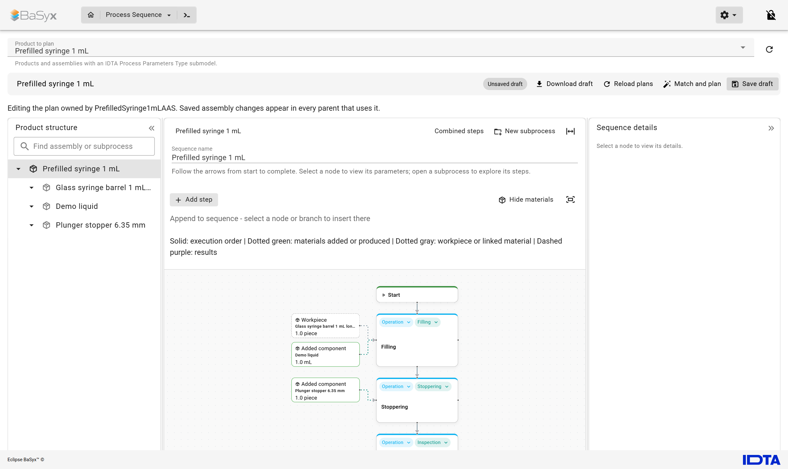
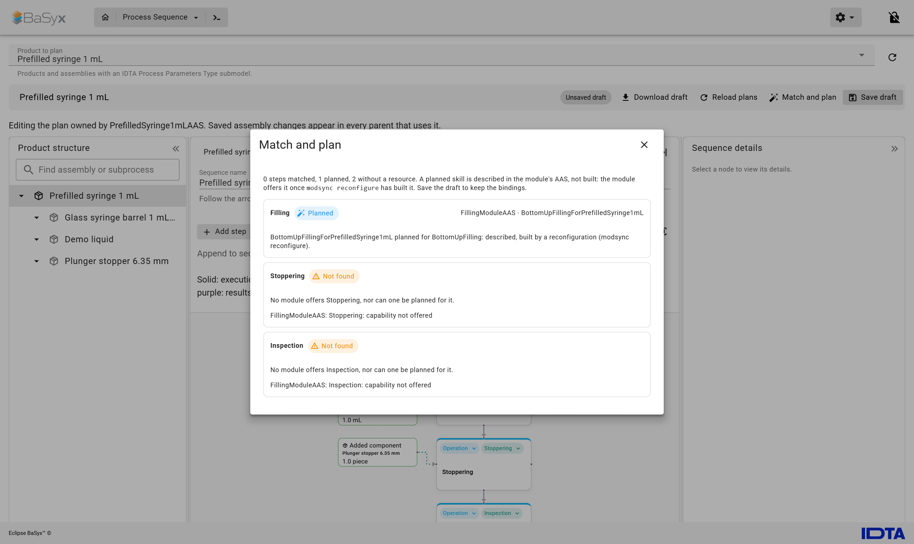
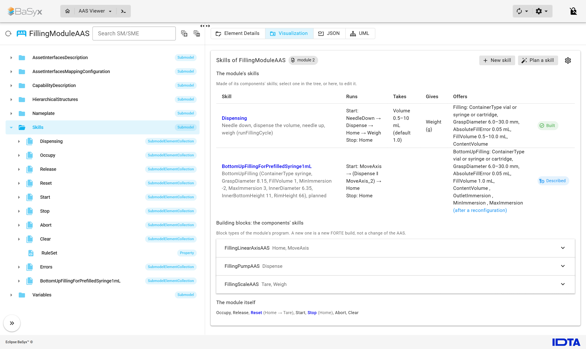
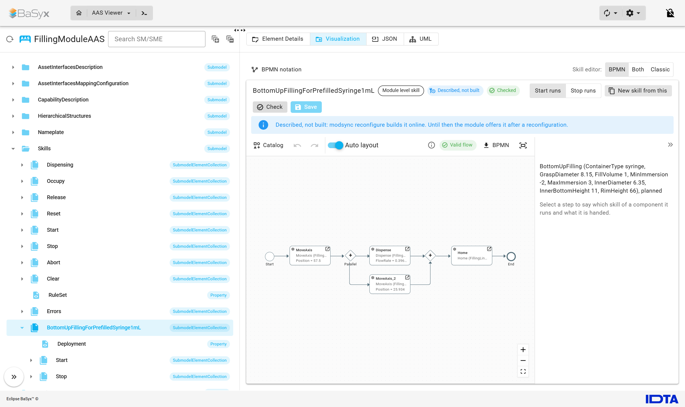

# AAS-driven planning and reconfiguration of IEC 61499 modules

Companion repository of the paper *From Product Requirements to Running Skills: AAS-Driven Planning and
Reconfiguration of IEC 61499 Modules* (M. B. Jensen, T. Schwörer, C. Schou; 60th CIRP Conference on Manufacturing
Systems, CIRP CMS 2027). It holds what is needed to replicate the paper's evaluation on the pharmaceutical filling
module, and the web UI with the skill editor and the Process Sequence module.

| Folder | What |
| --- | --- |
| `module/` | The filling module: its specification (`filling.yaml`) and its 4diac projects (`ModLib`, `FillingModule`) |
| `forte/` | Eclipse 4diac FORTE 3.3.0: the patches and the module's exported block types ([README](forte/README.md)) |
| `src/modplan` | The planner (goal regression with GTPyhop, parallel and coordinated steps) and the checker |
| `src/modreg` | The module's AASs from its specification, capability matching, and the skill service of the web UI |
| `src/modsync` | The synchroniser: reads the running program back, compares it with the AAS, changes it online |
| `src/modgen`, `src/iec61499_mgmt` | The module's IEC 61499 application from its specification; the management protocol and boot files |
| `ontology/` | The capability and skill vocabulary, and the rules that derive a module's offered capabilities |
| `aas/` | The AASs of the use case: the filling module, its components, the line, a 2 mL vial and a 1 mL syringe |
| `eval/` | The tests of Section 4, their analyses and the results they gave |
| `web-ui/` | Submodule: the BaSyx web UI with the skill editor and the Process Sequence module |

## Running it

Docker with Compose. Clone with the submodule:

```sh
git clone --recurse-submodules https://github.com/MartinJensen37/aas-driven-recon-iec61499.git
cd aas-driven-recon-iec61499
docker compose build eval            # FORTE from source and the Python tools, about 10 min
```

The tests (results are written to `eval/results`):

| Paper | Command | Runs |
| --- | --- | --- |
| 4.2 Matching, planning, checking | `docker compose run --rm eval python eval/match_plan_check.py` | 349 rows, a few minutes |
| 4.3 Deployment | `docker compose run --rm eval python eval/deployment.py` | 12 cells x 10 runs, about an hour |
| 4.3 Drift | `docker compose run --rm eval python eval/drift.py` | 105 runs, about 15 min |

Each test has an analysis that writes a summary beside its results; the deployment analysis also draws Fig. 5:

```sh
docker compose run --rm eval python eval/match_plan_check_analysis.py eval/results/match_plan_check-<when>.jsonl
docker compose run --rm eval python eval/deployment_analysis.py eval/results/deployment-<when>.jsonl --figure eval/results
docker compose run --rm eval python eval/drift_analysis.py eval/results/drift-<when>.jsonl
```

Every deployment and drift run starts a fresh FORTE with the module's boot file; the module's IO is simulated over
Modbus (`eval/module_sim.py`), and whether a product comes out right is judged by the process model
(`eval/process_model.py`). The results in `eval/results` are the runs reported in the paper.

## The web UI

```sh
docker compose up -d                 # BaSyx, the skill service, the web UI; publishes the use case's AASs
```

- **Process Sequence**: <http://localhost:3000/modules/processsequence>, *Product to plan*: Prefilled syringe 1 mL,
  then *Match and plan*. The syringe requires bottom-up filling, which no skill of the module offers, so a skill is
  planned for it and described in the module's AAS; the vial's filling is matched to the module's Dispensing skill.
- **Skill editor**: AAS Viewer, `FillingModuleAAS`, submodel `Skills`, tab *Visualization*: the module's skills; select
  a skill to edit its flow.

The AAS environment keeps its data in memory: `docker compose run --rm publish` publishes the AASs again.

| | |
| --- | --- |
|  |  |
|  |  |

## License

MIT, see [LICENSE](LICENSE). The web UI is Eclipse BaSyx's (MIT) with the lab's modules.
